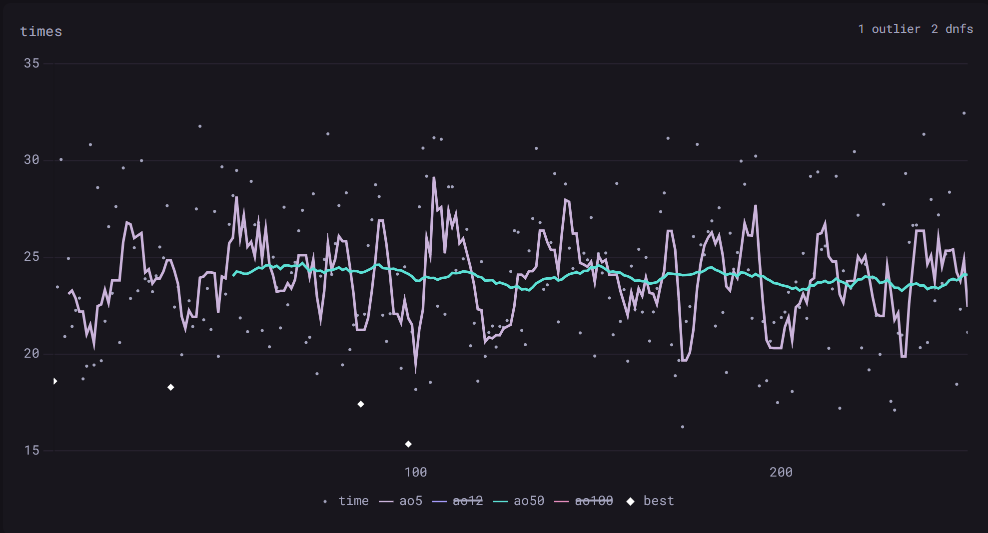
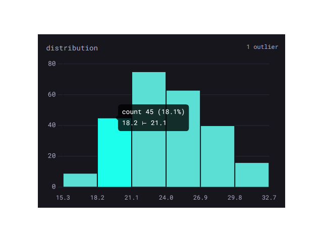
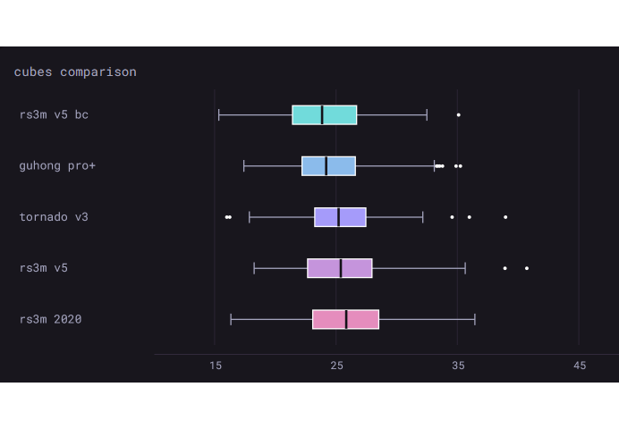
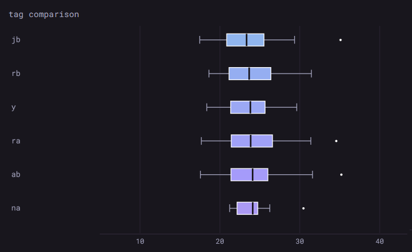
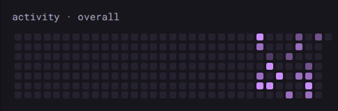
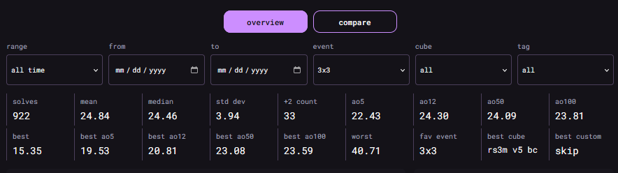

# datacube

Datacube is a browser-based speedcubing timer and analytics platform that turns your solving history into meaningful insights. Built with a focus on statistics and data visualization, it goes beyond traditional timing tools by providing interactive ways to explore your results, compare your puzzles, and understand how your performance changes over time.

### More than just averages

Your average time only tells part of the story. Datacube lets you examine your solving performance from multiple perspectives:

- **Track your progress:** Visualize individual solve times, rolling averages, and personal bests across your solving history.
  <div align="center">
    
  </div>
- **Understand your consistency:** Explore time distributions to see how your results are spread out, rather than relying exclusively on averages.
  <div align="center">
    
  </div>
- **Compare your cubes:** Use side-by-side statistical comparisons and boxplots to evaluate the performance and consistency of different puzzles.
  <div align="center">
    
  </div>
- **Analyze your practice:** Organize solves with custom tags to compare training categories, techniques, or practice conditions.
  <div align="center">
    
  </div>
- **Explore your activity:** Track your solving frequency through a calendar heatmap and examine how consistently you've been practicing.
  <div align="center">
    
  </div>
- **Focus on what matters:** Filter analytics by event, date range, cube, or tag to investigate specific subsets of your data.
  <div align="center">
    
  </div>

### Everything you need for everyday practice

Datacube also provides the essential features of a modern speedcubing timer:

- Responsive keyboard and touchscreen timing, with optional WCA event scrambles.
- Persistent solve history with timestamps, penalties, scrambles, and custom labels.
- User accounts with solve histories accessible across devices.
- Import support for csTimer, plus complete JSON backups and restoration.
- A responsive interface available in English, Brazilian Portuguese, and Spanish.

Whether you're experimenting with a new cube, working on your consistency, or simply curious about your long-term improvement, Datacube gives you the tools to explore your results beyond the timer.

## Run it locally

You’ll need Python 3.12+ and Node.js 22.18+ or 24+. Open two terminals from the repository root. These commands use PowerShell.

**Backend**

```powershell
python -m venv .venv
.\.venv\Scripts\python.exe -m pip install -r backend/requirements.txt
.\.venv\Scripts\python.exe -m alembic upgrade head
$env:DATACUBE_TURNSTILE_MODE = 'development'
.\.venv\Scripts\python.exe -m uvicorn backend.main:app --host 127.0.0.1 --port 8000 --reload --no-proxy-headers
```

**Frontend**

```powershell
Set-Location frontend
npm ci
npm run dev
```

Open the local address Vite prints, usually [localhost:5173](http://localhost:5173). The first time, create an account there. For another device on the same Wi-Fi, start the frontend with `npm run dev:lan`, open the network address Vite prints, and sign in with your existing account. The backend stays on port 8000 on the host. See [private HTTPS access](scripts/PRIVATE_ACCESS.md) for Tailscale Serve.

SQLite stores data in `backend/solves.db` by default. Back it up before upgrading an existing database. Use `DATABASE_URL` for an alternate database, and run `alembic upgrade head` after pulling new migrations.

## Bring your solves

Use the file buttons in settings to export or import a backup.

| Format | How it works |
| --- | --- |
| Datacube JSON | Export keeps your entire history, including timestamps, penalties, tags, scrambles, and event and cube associations. Restore adds missing solve IDs and skips IDs already on the account. A single restore file can be up to **32 MiB**. An export can be larger than that. |
| csTimer JSON or TXT | Pick which sessions to bring over and assign one event and an optional cube and tag to each. Solves keep their timestamps, times and penalties. Comments and scrambles are left out. The limit is **10 MiB** and **50,000 solves** per file. |

## Hosting

Build the frontend with `npm run build` in `frontend` and serve the resulting `frontend/dist` directory. Route `/api` to FastAPI on the same origin. For HTTPS, set `COOKIE_SECURE=true` on the backend.

Registration uses [Cloudflare Turnstile](https://developers.cloudflare.com/turnstile/). Development mode uses test keys on localhost. For a public site, use a Managed widget and set `DATACUBE_TURNSTILE_MODE=production`, `DATACUBE_TURNSTILE_SITE_KEY`, `DATACUBE_TURNSTILE_SECRET_KEY` and `DATACUBE_TURNSTILE_HOSTNAME` on the backend. The hostname should match the signup page, without a scheme or port. Keep the secret in the backend environment. [Hostname setup](https://developers.cloudflare.com/turnstile/additional-configuration/hostname-management/)

The defaults are 50,000 saved solves per account, 10 sign-in attempts per IP per minute, and 5 signups per IP per minute. Bulk imports and exports share their own limits. See [server settings](AGENTS.md#server-settings) for the environment variables and proxy setup.

## Development

The frontend is vanilla TypeScript, Vite, Bootstrap and Chart.js. The backend is FastAPI, SQLModel and Alembic. Run `npm test` and `npm run build` from `frontend`. Run `python -m pytest backend/tests` from the repository root with the virtual environment’s Python.

Event icons by Devin Corr-Robinett and the cubing/icons contributors, used under the MIT License. [cubing/icons](https://github.com/cubing/icons) · [License](frontend/public/event-icons/reference/LICENSE)

Scrambles are generated with [cubing.js](https://js.cubing.net/cubing/).
